# Codex 小助手：简约头像版

2026-10-27，内置 ImageGen 生成。用户要求比抱闪电的立体机器人更加简约。

仅保留薄荷绿圆角头像、深蓝短线眼睛和黄色天线点；微微歪头增加趣味。独立保存，不覆盖第一版。2026-10-27 经用户要求，已接入 0.3.1 / build 10 构建：应用图标及窗口标题区域使用本设计；macOS iconset 和 icns 由构建脚本生成。



## 提示词

```text
Use case: logo-brand. Asset type: one minimal macOS icon for a personal coding helper. Design a very simple original friendly robot face, slightly tilted with quiet playful personality. Only three visual elements: one softly rounded mint-green square head, two short deep-navy pill-shaped eyes, and one short navy antenna with a tiny warm yellow circular tip. No body, no hands, no lightning bolt, no mouth, no ears, no cheek details. Flat vector-like graphic design, clean precise silhouette, generous negative space, no 3D, no glossy material, no shading, no texture, no gradients. Make the head occupy about 65 percent of a centered ivory macOS rounded-square tile; the antenna subtly leans to one side. Two dominant colors mint and navy, tiny yellow accent. Strong silhouette and extremely readable at 16 and 32 pixels, whimsical but restrained, excellent optical balance. Square image, transparent outside a perfectly smooth rounded-square ivory tile with even outer padding about 9 percent of canvas. No lettering, no text, no code symbols, no branding, no watermark. Single final icon, not a presentation or comparison grid.
```
